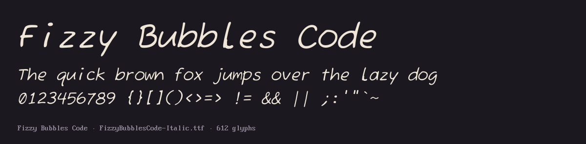

# Fizzy Bubbles Code

A hand-drawn, bubbly monospace font for programming, built from
[Fuzzy Bubbles](https://github.com/googlefonts/fuzzy-bubbles) by Robert E. Leuschke.

**Original:** <https://github.com/googlefonts/fuzzy-bubbles>




## What changed from Fuzzy Bubbles

- **Monospace:** every glyph sits in a 600-unit cell, wide ones squeezed, kerning and `fi`/`fl`/`ff` ligatures removed.
- **Look-alikes told apart:** slashed, narrower `0` vs `O`; tailed `l` vs `1` / `I` / `|`; `|` runs descender to ascender.
- **Punctuation:** `. , ; :` 1.5× bigger.
- **Brackets:** `[ ] { }` as tall as `( )`.
- **Operators:** `< > = - ~` bigger and on the `+` centre line, so `->`, `<=`, `==` line up.
- **Quotes:** straight, upright `'` and `"`.
- **Italic and Bold Italic:** Fuzzy Bubbles has no italic, so these are the uprights slanted 10° (box drawing stays upright).
- **Box drawing:** light and heavy lines `─│┌┐└┘├┤┬┴┼ ━┃┏┓┗┛┣┫┳┻╋`, half lines `╴╵╶╷`, rounded corners `╭╮╯╰`, blocks `█▀▄▌▐`.

## Install

Copy the four `FizzyBubblesCode-*.ttf` files (Regular, Bold, Italic, Bold Italic) to `~/Library/Fonts` (macOS) or
`~/.local/share/fonts` (Linux, then `fc-cache -f`). The family name is `Fizzy Bubbles Code`.

## Build

```sh
uv run --with fonttools build.py
```

Reads the original fonts in `source/` and writes all four `.ttf` files.

## Licence

SIL Open Font License 1.1, see [`OFL.txt`](OFL.txt). Fuzzy Bubbles © 2005 The Fuzzy Bubbles Project Authors;
modifications © 2026 AnissL93. Not affiliated with or endorsed by the original authors.
